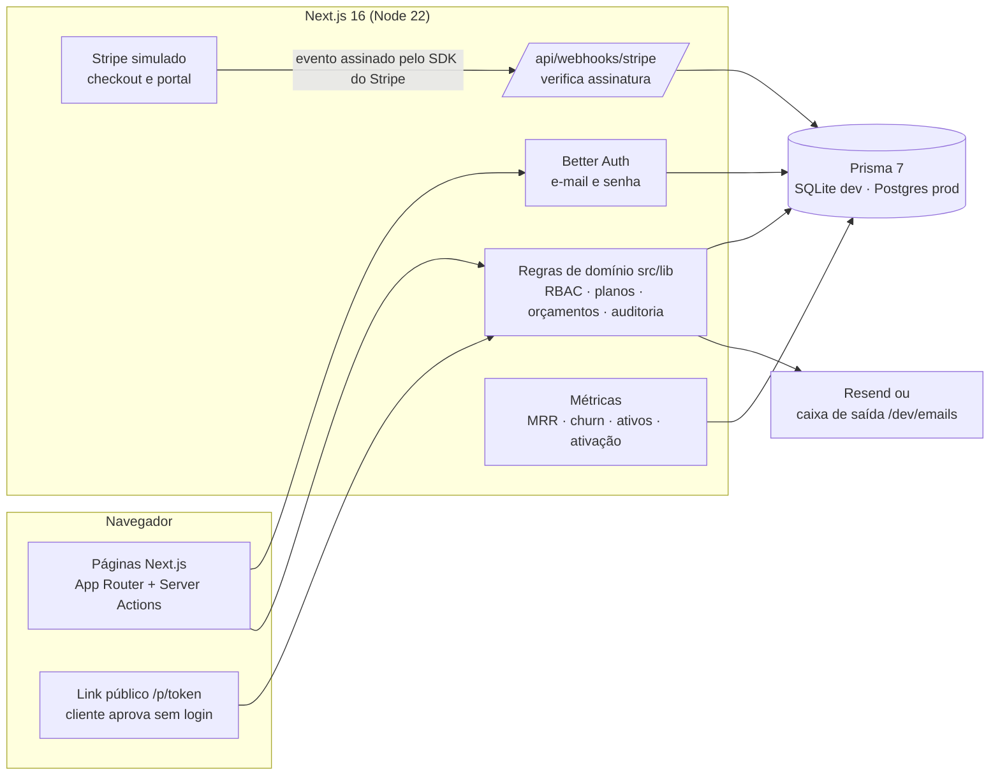
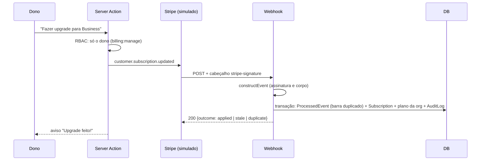

# Orçaí — SaaS de orçamentos com assinatura

Projeto 5 de 22 do catálogo de portfólio. É um SaaS completo de **assinatura**, construído em volta de um produto concreto: um gerador de orçamentos e propostas comerciais para pequenos negócios.

## O problema

Muitas marcenarias, oficinas e prestadores de serviço ainda fazem orçamento em planilha ou papel. As contas saem erradas, o visual não passa confiança e não dá para saber se o cliente abriu ou aprovou. O Orçaí resolve isso:

- **Orçamento pronto em minutos:** itens, quantidades e total calculado na hora.
- **Aprovação pelo link:** o cliente abre no celular e aprova com um toque.
- **Equipe com papéis:** quem vende, quem administra e quem só consulta.
- **Planos que acompanham o negócio:** Grátis, Pro e Business.

Por trás do produto está a base de um SaaS real: multi-organização, RBAC no servidor, cobrança recorrente com webhooks, limites por plano, auditoria e métricas de negócio.

## Demonstração

```bash
npm install
cp .env.example .env        # o seed e o modo fake funcionam com os valores de exemplo
npm run db:push
npm run db:seed             # conta demo + 60 empresas fictícias com 12 meses de história
npm run dev
```

As credenciais de teste locais criadas pelo seed estão no topo de `prisma/seed.ts`:

- **conta demo:** dona da "Marcenaria Bom Lar", no plano Pro;
- **admin da plataforma:** vê o painel `/admin`.

Os e-mails (convites) aparecem em `/dev/emails` enquanto não houver `RESEND_API_KEY`.

## O que tem

| Requisito                            | Como foi feito                                                                                                                                                                                                                  |
| ------------------------------------ | ------------------------------------------------------------------------------------------------------------------------------------------------------------------------------------------------------------------------------- |
| Organizações e convites por e-mail   | Workspaces próprios (`src/lib/orgs.ts`, `src/lib/team.ts`); convite com token de 7 dias, só aceito pelo e-mail convidado, revogável                                                                                             |
| RBAC owner/admin/member/viewer       | `src/lib/rbac.ts`: hierarquia de papéis checada **no servidor** em toda página, action e rota; quem não é membro recebe 404; admin não promove a dono; a org nunca fica sem dono                                                |
| Planos Free/Pro/Business com limites | `src/lib/plans.ts`: orçamentos por mês, assentos (membros + convites pendentes), cor da marca, exportação da auditoria                                                                                                          |
| Webhooks Stripe idempotentes         | `src/lib/billing/webhook.ts`: assinatura verificada com `constructEvent` do SDK oficial; `ProcessedEvent` na mesma transação da mudança; eventos fora de ordem descartados por `event.created`; assinatura cancelada não reabre |
| Dashboard admin                      | `/admin`: MRR (12 meses), churn de clientes e de receita, usuários ativos (DAU/MAU), ativação (1º orçamento em até 7 dias), empresas por plano                                                                                  |
| Audit log                            | `AuditLog` em convites, papéis, remoções, cobrança (inclusive ações do "Sistema (Stripe)"), exclusões e exportações; tela para admin e dono, e CSV no Business                                                                  |

## Arquitetura



### Fluxo de uma troca de plano



O plano da organização **só muda pelo webhook**. A interface nunca grava o plano direto, o que evita divergência com o Stripe.

## Como rodar

| Comando                                                       | O que faz                                                                 |
| ------------------------------------------------------------- | ------------------------------------------------------------------------- |
| `npm run dev`                                                 | Servidor de desenvolvimento em `http://localhost:3000`                    |
| `npm test`                                                    | 49 testes Vitest (unidade e integração com SQLite descartável `test.db`)  |
| `npm run test:e2e`                                            | Testes Playwright: build, `next start` na porta 3100 e banco `e2e.db`     |
| `npm run lint` · `npm run typecheck` · `npm run format:check` | Qualidade (também no CI)                                                  |
| `docker compose up --build`                                   | Sobe o app com o SQLite num volume (escrito, não testado; ver limitações) |

O CI (`.github/workflows/ci.yml`) roda formatação, lint, typecheck, testes, build e E2E.

### Variáveis (ver `.env.example`)

`DATABASE_URL`, `BETTER_AUTH_SECRET`, `BETTER_AUTH_URL`, `APP_URL`, `BILLING_MODE` (`fake` ou `stripe`), `STRIPE_SECRET_KEY`, `STRIPE_WEBHOOK_SECRET`, `STRIPE_PRICE_PRO`, `STRIPE_PRICE_BUSINESS`, `RESEND_API_KEY`, `EMAIL_FROM`, `PLATFORM_ADMIN_EMAILS` e `AUTH_RATE_LIMIT`.

## Decisões e trade-offs

- **Stripe simulado em vez do Stripe CLI.** O portfólio usa só ferramentas gratuitas e não há conta Stripe.
  - O "Stripe simulado" (`src/lib/billing/fake-stripe.ts`) gera eventos no formato da API e os assina com `stripe.webhooks.generateTestHeaderString`.
  - Os eventos chegam por HTTP ao mesmo endpoint que o Stripe usaria, e o caminho de verificação e processamento é o de produção.
  - Os E2E percorrem checkout, upgrade, downgrade e cancelamento por esse caminho, no lugar de `stripe trigger`.
  - Com `BILLING_MODE=stripe`, o checkout cria uma Checkout Session de verdade (código escrito, não testado).
- **Organizações próprias em vez do plugin de organização do Better Auth.** O RBAC fica explícito, com quatro papéis (incluindo _viewer_) e testável sem HTTP. O Better Auth cuida só de identidade e sessão.
- **SQLite no dev, schema portável.** Os "enums" são `String` validados em TypeScript, então o mesmo schema serve ao Postgres.
- **Eventos fora de ordem:**
  - um evento com `created` menor que o último aplicado é marcado como `stale` e ignorado;
  - uma assinatura `canceled` é final, como no Stripe;
  - o plano da org é recalculado a partir de _todas_ as assinaturas dela, então um cancelamento atrasado de uma assinatura antiga não derruba a nova.
- **Cancelamento no fim do período.** O cliente mantém o plano pago até lá. Na simulação há um botão "Simular fim do período".
- **Downgrade com equipe acima do limite.** Os membros atuais ficam, mas novos convites são bloqueados (não removemos ninguém automaticamente).
- **Next 16 com Cache Components.** Toda leitura de sessão fica atrás de `<Suspense>`. Um efeito colateral: o `notFound()` de uma página em streaming chega com HTTP 200, embora o conteúdo seja a página 404.

## Limitações

- O Docker Compose e o Dockerfile foram escritos, mas **não testados**: o notebook de desenvolvimento não tem Docker.
- A troca para Postgres exige três passos, documentados e não testados:
  - `provider = "postgresql"` no schema;
  - o adapter `@prisma/adapter-pg` em `src/lib/db.ts`;
  - uma URL `postgresql://`.
- **MRR histórico:** usa o preço atual de cada assinatura (trocas de plano no meio do histórico não são reconstruídas).
- **Cliente e e-mail:** o cliente aprova o orçamento sem identificação. Não há verificação de e-mail no cadastro nem recuperação de senha.
- **Modo `stripe` real:** o Billing Portal ainda não está ligado; a troca de plano usa os botões do modo simulado.

## Próximos passos

1. Testar o modo `BILLING_MODE=stripe` com uma conta de teste e o Stripe CLI (`stripe listen`), e ligar o Billing Portal.
2. Postgres com o adapter `pg` e migrações (`prisma migrate`) no lugar do `db push`.
3. Verificação de e-mail e recuperação de senha (Better Auth já oferece), e login com Google.
4. PDF do orçamento e envio pelo WhatsApp; notificar a empresa quando o cliente aprovar.
5. Uso medido por plano com alertas antes do limite; período de teste (_trial_) do Pro.
6. Coortes de retenção e funil de conversão (Grátis → pago) no painel `/admin`.
7. Testar a imagem Docker e publicar uma demo.
